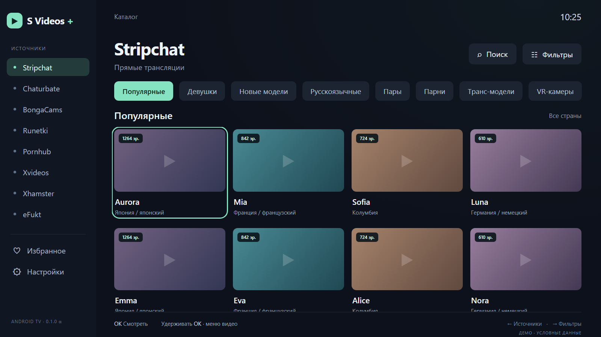

# S Videos +

Отдельное Android TV-приложение. Дизайн Calm: тёмный фон, мятный акцент, источники слева,
четыре карточки в ряд, категории сверху, выдвижные фильтры справа.



На изображении тестовые данные. APK загружает реальные каталоги адаптеров.
Подробный протокол проверки и ограничения: [VALIDATION.md](VALIDATION.md).

## Установка

**[Скачать APK 0.1.0-alpha.11](https://github.com/kostuasoftball/s-videos-plus/releases/download/v0.1.0-alpha.11/S-Videos-Plus.apk)**
· [Инструкция установки](INSTALL.md)

Устанавливается **APK**, а не JavaScript-ссылкой в Lampa. Lampa для запуска не нужна.
Минимум Android 6.0 (API 23), современный Android System WebView, пульт с D-pad/OK/Back.
Тестовые APK публикуются в разделе Releases этого репозитория после успешной сборки.
APK подписывается отдельным постоянным ключом приложения, предназначен для тестовой
установки и не опубликован в Google Play. Закрытый ключ хранится вне Git и в GitHub Secrets.

## Что реализовано

- Настройки → Зеркала: сохранение предпочтительного адреса или автоматический резерв для шести поддерживаемых источников.
- Настройки → Проверить обновления: GitHub Releases, скачивание APK, проверка SHA-256, пакета, версии и подписи, затем системный установщик. Тихая установка без подтверждения Android не поддерживается.
- Актуальные результаты проверки семи источников и 33 адресов: [reports/](reports/README.md). Pornhub остаётся нестабильным.
- Независимая копия восьми адаптеров: Pornhub, Xvideos, Xhamster, eFukt, BongaCams,
  Runetki, Chaturbate, Stripchat.
- Каталог, пагинация, поиск, категории, фильтры источников.
- Stripchat: один список стран с невыбираемыми заголовками континентов.
- Управление пультом: стрелки перемещают фокус, OK выбирает, Back закрывает панель;
  справа от крайней карточки открываются фильтры. Удержание OK открывает меню видео.
- Нативный Media3-плеер с кнопками предыдущего/следующего видео, качества и закрытия;
  после закрытия возвращается фокус карточки. Следующее видео разрешается адаптером по запросу.
- Необязательные Cookie-сессии Stripchat/Chaturbate и чтение избранного. Гостевой каталог
  не зависит от авторизации. Сессии шифруются Android Keystore, резервные копии приложения отключены.
- HTTPS-запросы выполняются нативно, без browser-CORS. В alpha.4 резервный сторонний прокси
  по умолчанию включён в автоматическом режиме; сохранённый выбор пользователя учитывается.
  Сессионные запросы через сторонние прокси никогда не проходят.
- Превью загружаются нативно с Referer и резервным маршрутом. Media3 маршрутизирует каждый
  запрос HLS (master/variant/segment/key), сохраняя исходные URI и байтовые диапазоны.
  В настройках доступны автоматический, принудительный режимы и собственный HTTPS-прокси.
  Исходник необязательного приватного Worker и инструкция: [proxy/](proxy/README.md).

## Архитектура

Android `MainActivity` отображает только локальный интерфейс через защищённый origin.
Мост Android доступен исключительно локальной странице: внешние сайты открываются отдельным
браузером. `NetworkClient` выполняет запросы, `SecureStore` хранит настройки,
`PlaybackHost` управляет Media3 и жизненным циклом плеера.

Локальные HTML/CSS/JS позволяют перенести интерфейс из утверждённого эскиза без зависимости
от внутренних компонентов Lampa. `model.js` хранит состояние каталога и отсекает запоздавшие
ответы старого источника. `adapters/` содержит независимые парсеры с прежним контрактом.
Это собственное приложение, а не модификация APK Lampa и не загрузчик удалённого плагина.

## Сборка и проверка

Java 17, Android SDK 35, Gradle 8.11.1, Android Gradle Plugin 8.9.2.

```sh
npm test
gradle assembleDebug lintDebug
```

GitHub Actions собирает и проверяет подписанный release APK. Тег `v*` публикует prerelease.

Для проверки интерфейса без подключения к сайтам:

```sh
npm install
npx playwright install chromium
npm run test:ui
npm run preview
```

Демо доступно локально по `http://127.0.0.1:4173/?demo=1`. Оно явно помечено и не показывает
реальные модели. Обычный APK работает с реальными адаптерами и не включает демо автоматически.

## Ограничения alpha

API, HTML, региональные ограничения и anti-bot сайтов могут меняться. Нативная сеть не
обходит CAPTCHA и блокировки. Наличие адаптера не является доказательством доступности сайта
в сети пользователя. Перенос Cookie на другое устройство также может быть отклонён сайтом.
Требуется проверка физического Android TV, реального пульта, декодеров HLS/MP4 и аккаунтов.
Автоматический Live TV-таймер не переносился. Внешний плеер Lampa не является частью этого приложения.

Исходный плагин и его репозиторий остаются отдельными и не изменяются этим проектом.
Происхождение перенесённых модулей описано в `THIRD_PARTY.md`.
